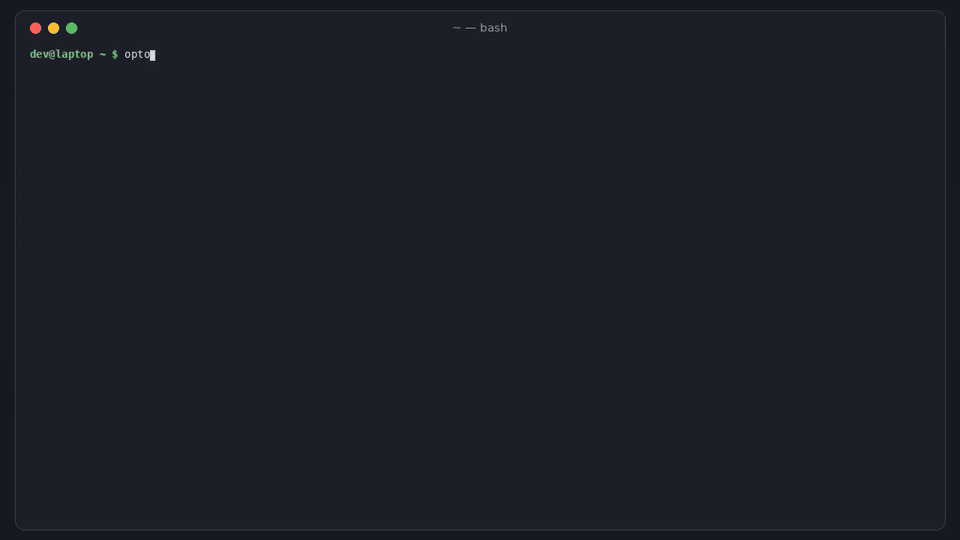

# optout

[](https://github.com/hamarshehmhmd/optout/actions/workflows/ci.yml)
[](LICENSE)


**You turned off "train on my data". Is it still off?**

Teams switch off training and data sharing in ChatGPT/Codex, Claude, Gemini, Cursor and Copilot, then find it back on. In November 2026 a company whose developers had all disabled data sharing found ["Improve the model for everyone" silently re-enabled in Codex](https://news.ycombinator.com/item?id=50352757) (535 points on HN), two months after [another user logged the same thing](https://news.ycombinator.com/item?id=49643556). Vendors also move the defaults: [GitHub started training on Copilot Free/Pro/Pro+ interaction data from Apr 24 2026 unless you opt out](https://github.blog/changelog/2026-03-25-updates-to-our-privacy-statement-and-terms-of-service-how-we-use-your-data/), [Mistral's Pro tier is opted in by default](https://news.ycombinator.com/item?id=49535284), and [installing Cursor's iOS app moved people off the legacy no-storage privacy mode](https://news.ycombinator.com/item?id=48737226). On top of the account toggle, every CLI and editor has its own telemetry, feedback-upload and transcript settings. Nobody can say on a given day which of them are still off.

`optout` checks all of it from one command, fixes what can be fixed locally, keeps a dated record of the account toggles it can't read, and tells you when something got weaker or a vendor's terms page changed.



```sh
curl -fsSL https://raw.githubusercontent.com/hamarshehmhmd/optout/main/install.sh | sh
```

(or `pipx install git+https://github.com/hamarshehmhmd/optout` / `uv tool install git+https://github.com/hamarshehmhmd/optout`. No dependencies, Python 3.9+.)

## What it does

| Command | What you get |
|---|---|
| `optout scan` | One table: every data control on this machine for Claude Code, Codex, Gemini CLI, Cursor, VS Code / VSCodium / Windsurf, Copilot and Aider. Each line shows the value, the file it came from and the documented fix. `--format json\|md`, `--fail-on bad\|warn\|todo`. |
| `optout fix [--write]` | Writes the opt-outs vendors document into your user config files. Dry run by default, keeps a backup of every file, keeps comments in TOML/JSONC. |
| `optout accounts` / `open` / `attest` | The toggles that live on vendor servers (ChatGPT, Claude, Gemini apps, Copilot, Mistral, Cursor): the exact setting, the link, and when you last saw it off. `optout attest chatgpt off` records today's check, and it goes stale after `--max-age` days (default 14). |
| `optout baseline` / `optout drift` | Save today's state, then later list anything that got **weaker** (exit 3). This catches a re-enabled setting, an edited config, or a downgraded Cursor privacy mode. |
| `optout terms [--diff]` | Snapshots the vendors' privacy, terms and data-use pages and shows a diff when one changes (exit 3). |

### What `scan` reads

| Tool | Settings checked | Where |
|---|---|---|
| Claude Code | `DISABLE_TELEMETRY`, `DISABLE_ERROR_REPORTING`, `DISABLE_FEEDBACK_COMMAND`, `CLAUDE_CODE_DISABLE_FEEDBACK_SURVEY`, `CLAUDE_CODE_DISABLE_NONESSENTIAL_TRAFFIC`, `DO_NOT_TRACK`, Bedrock/Vertex/Foundry provider, OTel prompt export, `cleanupPeriodDays`, claude.ai login | shell env, `~/.claude/settings.json` `env`, managed-settings.json, `~/.claude.json` ([docs](https://code.claude.com/docs/en/data-usage)) |
| Codex | `analytics.enabled`, `feedback.enabled`, `history.persistence`, `otel.log_user_prompt`, ChatGPT vs API-key login | `$CODEX_HOME/config.toml`, `auth.json` (mode only; tokens are never read out) ([docs](https://developers.openai.com/codex/config-reference)) |
| Gemini CLI | `privacy.usageStatisticsEnabled`, `telemetry.enabled` / `logPrompts` / `target`, `GEMINI_TELEMETRY_*`, auth type (unpaid API keys are [used to improve Google products](https://ai.google.dev/gemini-api/terms)) | `~/.gemini/settings.json`, `./.gemini/settings.json`, system settings ([docs](https://github.com/google-gemini/gemini-cli/blob/main/docs/reference/configuration.md)) |
| Cursor | **Privacy Mode as cached from your account** (`NO_STORAGE` / `NO_TRAINING` / training allowed), partner data sharing, editor telemetry | `User/globalStorage/state.vscdb`, opened read-only |
| VS Code, Insiders, VSCodium, Windsurf | `telemetry.telemetryLevel` | `User/settings.json` (Linux, macOS and Windows paths) |
| GitHub Copilot | extension installed, so the account training toggle applies | editor extension dirs |
| Aider | analytics opt-in | `~/.aider/analytics.json` |

Statuses: `OK` off / safe · `WARN` on, or vendor default on · `BAD` training or data sharing on · `TODO` account toggle never checked · `OLD` last check is stale · `info` worth knowing (e.g. local transcript retention).

## Usage

```sh
optout                      # same as: optout scan
optout fix                  # see what it would change
optout fix --write          # do it (backups: *.optout-bak-<time>)
optout accounts             # what to check by hand, with links
optout open claude          # opens claude.ai privacy settings
optout attest claude off    # record what you saw (stored locally, dated)
optout baseline             # remember today's state
optout drift                # later: what got weaker? exit 3 if anything
optout terms --diff         # did a vendor change its privacy/terms page?
```

Run it on a schedule so drift shows up within a day:

```sh
# crontab -e
17 9 * * *  ~/.local/bin/optout drift >/dev/null || notify-send "optout: an AI data control got weaker"
23 9 * * 1  ~/.local/bin/optout terms >/dev/null || notify-send "optout: a vendor privacy page changed"
```

For a team, push it with your MDM or dotfiles and collect `optout scan --format json` (or `--format md` as audit evidence). `optout scan --fail-on warn` exits 1 when anything is on.

State (attestations, baseline, page snapshots) lives in `~/.local/state/optout` (macOS: `~/Library/Application Support/optout`, Windows: `%LOCALAPPDATA%\optout`) or `$OPTOUT_STATE_DIR`.

## Demo

[`demo.mp4`](https://github.com/hamarshehmhmd/optout/releases/download/v0.1.0/demo.mp4) (narrated, 2 min 49 s) runs every command against a fake home directory built by [`examples/make_demo_home.py`](examples/make_demo_home.py):

```sh
python examples/make_demo_home.py /tmp/demo-home
optout --home /tmp/demo-home scan
optout --home /tmp/demo-home fix --write
```

## Limits

- **optout can't read server-side toggles.** ChatGPT, Claude, Gemini apps, Copilot and Mistral keep "train on my data" on their servers, behind your login. optout gives you the exact setting, the link and a dated record, but it can't confirm the toggle for you. The exception is Cursor: optout reads the privacy mode Cursor caches locally from your account. That copy is only as fresh as Cursor's last sync.
- Settings keys change. Every rule cites the vendor doc it's based on (checked Nov 2026). If a tool renames a key, open an issue.
- `optout fix` only writes local, documented opt-outs. It never touches Cursor's state DB, managed or system settings, or anything server-side. `DISABLE_TELEMETRY` also turns off Claude Code's feature flags, which can make Remote Control unavailable.
- `optout terms` can't get past bot walls. openai.com returns HTTP 403 to scripts, so `openai-privacy` shows as an error, not "unchanged". Pass your own list with `--pages pages.json` (`{"pages": [{"id": "...", "url": "..."}]}`). Some pages have dynamic text, so a change can be noise. Read the diff.
- optout isn't legal advice, and an opt-out doesn't remove data a vendor already used.

## Development

```sh
python -m venv .venv && . .venv/bin/activate
pip install -e . pytest
pytest -q
python demo/render.py   # rebuilds demo.mp4 (needs ffmpeg, edge-tts, Pillow)
```

## License

GNU Affero General Public License v3.0 or later ([LICENSE](LICENSE)), SPDX `AGPL-3.0-or-later`.

**Commercial licenses** without the AGPL obligations (for example, to embed optout in a closed-source product or an internal compliance platform) are available from the author, Mohammad Hamarsheh. Open an issue or contact [@hamarshehmhmd](https://github.com/hamarshehmhmd).
